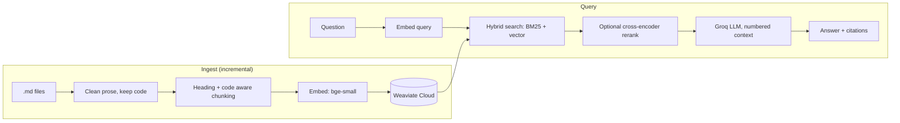

# techdocs-rag

Retrieval-augmented Q&A over technical markdown documentation, built without an orchestration framework.
Hybrid search (BM25 + vectors) on **Weaviate Cloud**, local **bge-small** embeddings, **Groq** for generation,
a **FastAPI** service, and an **evaluation harness** so every retrieval decision is measured instead of guessed.



## Design decisions

| Decision | Why | Trade-off |
|---|---|---|
| Heading-path prefix on every chunk | Keeps section context in both the embedding and the LLM prompt | Slightly larger chunks |
| Fenced code blocks are atomic | Splitting a command or config mid-block makes answers wrong | Very long blocks are re-wrapped in fences and split by lines |
| Clean prose only, never code | Naive tag stripping destroys `List<String>`, JSX, etc. | Slightly more complex cleaner |
| Hybrid search (`alpha` tunable) | Exact tokens (`ERR_CONN_RESET`, `--no-cache`) are weak spots for pure vector search | Two signals to tune; measured by the eval harness |
| Optional cross-encoder reranker | Higher precision for the final top-k | Extra latency and a second model; off by default |
| Content-hash incremental ingest | Unchanged files are skipped; deleted files are pruned | Hash stored per chunk in Weaviate |
| Exact-match tokenization on `source`/`file_hash` | Word tokenization makes filters match unrelated paths | Those fields are excluded from BM25 |
| No-results guardrail + prompt-injection note | Never asks the LLM to answer from nothing; treats docs as untrusted text | None significant |
| Dependency injection (store, embedder, LLM are parameters) | Unit tests run in milliseconds with fakes, no network | A few small protocols to maintain |

## Quickstart

```bash
python -m venv .venv && source .venv/bin/activate     # Windows: .venv\Scripts\activate
make install
cp .env.example .env        # fill in WEAVIATE_URL, WEAVIATE_API_KEY, GROQ_API_KEY, then export them

techdocs-rag ingest                       # indexes data/sample_docs (use --data-dir for your own docs)
techdocs-rag ask "How do I fix ERR_AUTH_EXPIRED?"
techdocs-rag serve                        # http://127.0.0.1:8000/docs
```

```bash
curl -s localhost:8000/ask -H 'content-type: application/json' \
  -d '{"question": "What is the max page size?", "top_k": 5}'
```

## Evaluation

`eval/questions.jsonl` holds labelled questions (expected source, expected section, keywords the answer must contain).
`techdocs-rag eval --alphas 0 0.5 1` sweeps keyword-only, hybrid and vector-only retrieval and writes `eval/results.md`.
Add `--answers` to also score generated answers by keyword recall (uses Groq quota).

Metrics: hit@k, MRR, answer keyword recall, p50/p95 retrieval latency.

**Results** (fill in after running `make eval` against your own docs; the bundled sample set is tiny and only proves the harness works):

| alpha | hit@5 | MRR | answer kw recall | p50 ms | p95 ms | n |
|---|---|---|---|---|---|---|
| 0 (BM25) | | | | | | |
| 0.5 (hybrid) | | | | | | |
| 1 (vector) | | | | | | |

For a meaningful result, point `DATA_DIR` at a real documentation set, write 30-50 questions, and report the table
plus one failure analysis (what the weakest questions had in common and what you changed).

## Layout

```
src/techdocs_rag/
  loading.py     find/load/clean markdown        chunking.py   heading + code aware splitter
  embeddings.py  local embedder (lazy load)      rerank.py     optional cross-encoder
  store.py       Weaviate Cloud wrapper          ingest.py     incremental ingest pipeline
  rag.py         retrieve + grounded generation  llm.py        Groq client with retries
  evaluate.py    metrics + question loader       api.py        FastAPI service
  cli.py         ingest / ask / eval / serve     config.py     env-driven settings
tests/           unit tests with fakes (no network needed)
```

## Tests and CI

`make test` runs 20 unit tests covering chunking edge cases, cleaning, incremental ingest and pruning, the
no-results guardrail, metric maths and the API. CI runs ruff and pytest on every push without installing the ML stack.

## Limitations and next steps

- Retrieval quality numbers depend on your corpus; the bundled data is a smoke test, not a benchmark.
- No streaming responses, auth or rate limiting on the API yet.
- Possible additions: query rewriting for follow-up questions, response caching, tracing (OpenTelemetry),
  LLM-as-judge faithfulness scoring, and per-version filtering for multi-version docs.